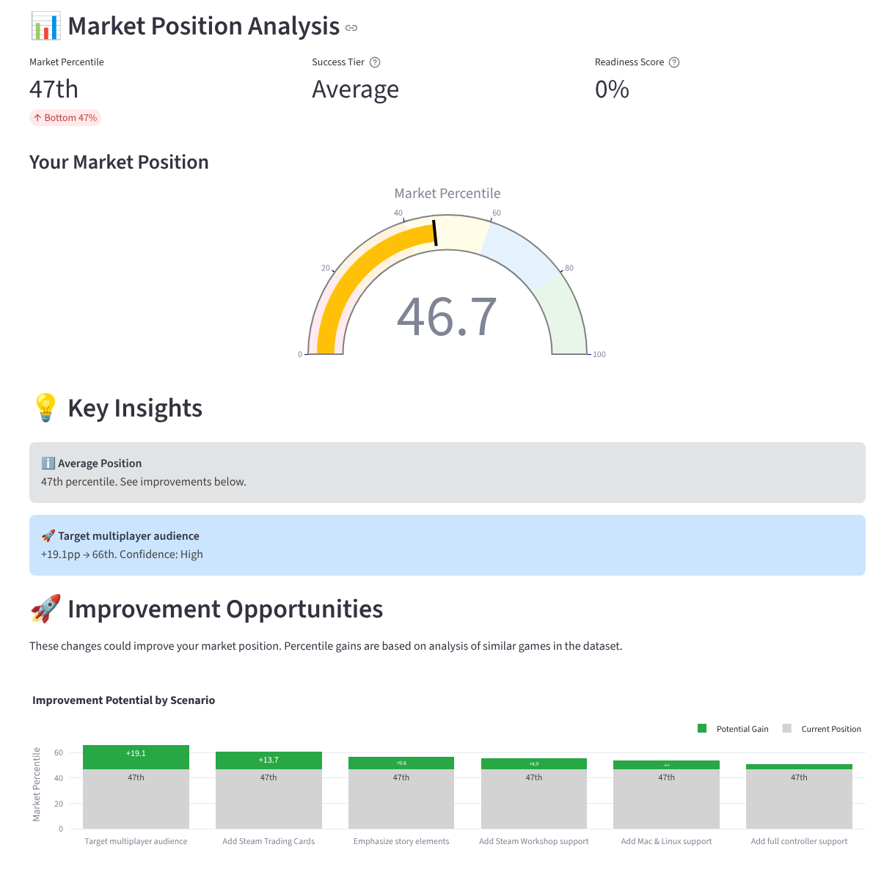
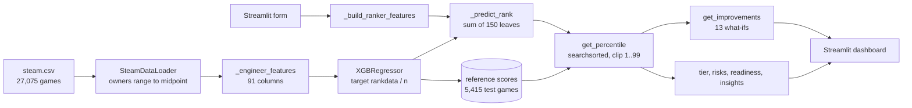
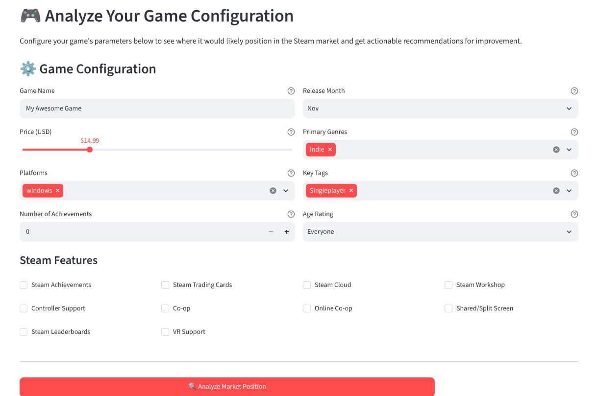

<p align="center">
  
</p>

<p align="center">
  
  
  
  
  
</p>

<p align="center">
  <a href="https://cocopops9.github.io/Game_Launch_IDSS/"><b>Open the Interactive Lab</b></a> ·
  <a href="docs/README.md"><b>Guided documentation</b></a> ·
  <a href="#quick-start"><b>Quick start</b></a> ·
  <a href="#limitations"><b>Limitations</b></a>
</p>

**Game Launch IDSS** is an Intelligent Decision Support System for game developers. You describe a game you have not
released yet (price, platforms, genres, tags, Steam features) and the system tells you **where it would rank among
27,075 Steam games** and **which single change would move it up the most**, with a confidence label for each suggestion.
It is a Streamlit application built on an XGBoost model trained to predict the *order* of games by owners.

## Contents

1. [What you get](#what-you-get)
2. [How it works, in six animated steps](#how-it-works-in-six-animated-steps)
3. [Try it interactively](#try-it-interactively)
4. [Measured performance](#measured-performance)
5. [Quick start](#quick-start)
6. [Using the app](#using-the-app)
7. [Using the ranker from Python](#using-the-ranker-from-python)
8. [Project structure](#project-structure)
9. [Documentation map](#documentation-map)
10. [Limitations](#limitations)

## What you get

<p align="center"></p>
<p align="center"><sub>The real app, default form values: 46.7th percentile, tier <i>Average</i>, best improvement <i>Target multiplayer audience</i> (+19.1 points).</sub></p>

| Output | What it is | Computed by |
|---|---|---|
| **Market percentile** (1 to 99) | how the model's score for your game compares with its scores for 5,415 real held-out games | `IntelligentRanker.get_percentile` |
| **Tier** | exceptional, strong, above average, average, below average, struggling | fixed thresholds 95, 80, 60, 40, 20 |
| **Improvement scenarios** | 13 one-feature changes re-scored by the same model; the six largest gains above 0.5 points | `IntelligentRanker.get_improvements` |
| **Confidence** per scenario | High or Low when the feature was checked against held-out data, Medium otherwise | `_validate_improvements` |
| **Risks** | single platform, price above $40, percentile below 30 | `IntelligenceEngine._assess_risks` |
| **Readiness score** | 30 for 2+ platforms, 20 for achievements, 20 for Trading Cards (maximum 70) | `_analyze_success_factors` |
| **Saved configurations** | compare several versions of your game, export them to CSV | `persistence.py`, `my_games.py` |

## How it works, in six animated steps

Every figure below is an animated SVG generated from the real trained model (snapshot of 2026-10-22), not an illustration.

<p align="center"></p>

The system has two lanes. The **training lane** runs once per browser session and builds the model and its reference
distribution. The **inference lane** runs at each click on *Analyze Market Position*.

### 1. Data: 27,075 games with owners known only as ranges

<p align="center"></p>

SteamSpy reports owners as 13 ranges; 68.7% of games sit in the lowest one (0 to 20k). This censored, heavy-tailed target is why
the system predicts *order* instead of owner counts. [Chapter 3](docs/03_dataset.md)

### 2. Features: one row becomes 91 numbers

<p align="center"></p>

Price, time, platforms, achievements, age rating, 12 Steam categories, 12 genres, 26 SteamSpy tags, developer and publisher
size. Only information available before launch is used; ratings and playtime are excluded. [Chapter 4](docs/04_feature_engineering.md)

### 3. Target and model: 150 boosted trees learn the rank of each game

<p align="center"></p>

Owners are replaced by `rankdata(owners) / n`, then an `XGBRegressor` (150 trees, depth 6, learning rate 0.08) is fitted on
21,660 games. Each tree corrects the residual errors of the previous ones:

<p align="center"></p>

[Chapter 5](docs/05_gradient_boosting.md) · [Chapter 6](docs/06_rank_target_and_spearman.md)

### 4. Score to percentile: compare with 5,415 real held-out games

<p align="center"></p>

The game's score is located among the model's scores for the test games with `np.searchsorted`, then clipped to [1, 99].
[Chapter 7](docs/07_percentile_mapping.md)

### 5. What-if engine: 13 counterfactual changes

<p align="center"></p>

One feature is changed at a time, the percentile is recomputed, and gains above 0.5 points are ranked.
[Chapter 8](docs/08_what_if_engine.md)

### 6. Decision layer: tiers, risks, readiness

<p align="center"></p>

Deterministic rules turn the percentile into the labels and warnings shown in the app. [Chapter 9](docs/09_decision_layer.md)

## Try it interactively

GitHub does not run JavaScript inside a README, so the interactive part lives in **[the Interactive Lab](https://cocopops9.github.io/Game_Launch_IDSS/)**
(`docs/index.html`). It runs the project's exported XGBoost trees in your browser and walks through ten linear steps:

| Step | You can |
|---|---|
| Pipeline | click the six stages to see the function that implements each |
| Data | switch log/linear scale; compare the ranker's random split with the owners model's temporal split |
| Configure | use the same form as the Streamlit app, or load one of four presets |
| Feature mapping | watch the 91 cells light up; see which inputs never reach the model |
| Gradient boosting | fit a boosted model live on toy data with three learning rates; inspect any of the 150 real trees for your game |
| Rank target | distort or add noise to 800 held-out scores and compare Spearman with Pearson |
| Percentile | see your score on the curve of 5,415 reference scores |
| What-if | see all 13 candidates and their status; *apply* one through the form and compare with the engine's prediction |
| Dashboard | the app's gauge, tier, readiness, insights and risks, live |
| Validation | metrics and held-out games with predicted vs actual percentiles |

On load, the lab re-evaluates 25 stored test rows and reports its largest difference from Python's `model.predict` (2.5e-7).
It reproduces the app's percentiles and recommendations exactly.

> **Opening the lab.** If the link above is not live yet, enable it once: *Settings → Pages → Deploy from a branch → `main` / `docs`*.
> Without Pages, open `docs/index.html` directly in a browser (works from disk), or run `python -m http.server 8000 --directory docs`.

The architecture can also be explored as a zoomable diagram, rendered by GitHub:



## Measured performance

All values come from running the repository's code (XGBoost 3.4.1, pandas 2.3.3). Rows marked * were computed for the
documentation with the same model recipe; the app does not show them.

| Model | Used for | Split | Metric | Value |
|---|---|---|---|---:|
| **Ranker** | percentile and recommendations | random 80/20 (21,660 / 5,415) | Spearman ρ | **0.725** |
| Ranker * | | random 80/20, 1,000 bootstrap resamples | 95% interval of ρ | 0.712 to 0.738 |
| Ranker recipe * | | temporal: before 2018 / from 2018 | Spearman ρ | **0.432** |
| Owners regression | Market Data tab | temporal (16,702 / 10,373) | R² on log owners | 0.362 |
| Owners regression | Market Data tab | temporal | Spearman ρ | 0.429 |
| Review-ratio regression | Market Data tab | temporal | R² / MAE | 0.110 / 0.197 |

The random-split figure measures how well the model orders games from the same period. For a game that has not launched,
the temporal figure is the more realistic estimate. Details: [chapter 6](docs/06_rank_target_and_spearman.md) and
[chapter 10](docs/10_secondary_models_and_validation.md).

## Quick start

**Requirements:** Python 3.10 or later and the packages in `requirements.txt`. `steam.csv` is already in the repository.

```bash
git clone https://github.com/cocopops9/Game_Launch_IDSS.git
cd Game_Launch_IDSS

python -m venv .venv
source .venv/bin/activate          # Windows: .venv\Scripts\activate

pip install -r requirements.txt
streamlit run app.py
```

Streamlit opens `http://localhost:8501`. The first time the *Analyze New Game* tab loads, the app reads the data and trains the
models: about **1.5 minutes** (83 s measured). Later clicks take milliseconds. Models live in memory only: restarting the server
retrains them, and every training run writes a `training_report_YYYYMMDD_HHMMSS.md` file into the working directory.

> **pandas version.** Use pandas 2.x (`requirements.txt` pins `pandas<3`). With pandas 3, the loader no longer recognizes the
> owners column as text, every game gets the same owner count, and the ranker cannot be evaluated.

## Using the app

| Tab | What to do |
|---|---|
| **🎮 Analyze New Game** | Name the game, set price, platforms, achievements, release month, genres, tags, age rating and Steam features, then click **Analyze Market Position**. Read the percentile, tier, insights, improvement chart, risks and checklist. Click **Save This Configuration** to keep it. |
| **📚 My Configurations** | Compare saved configurations in a table sorted by percentile, inspect each one, delete single configurations or whole games, export everything as CSV. Saved data lives in `data/saved_games.json`. |
| **📊 Market Data** | Explore the dataset: feature importance of the owners model, correlations (pick the features of the heatmap), model performance, price and platform statistics. Available after the first tab has loaded the models. |

<p align="center"></p>

A practical workflow: start from your current plan, analyze it, apply the top suggestion that is realistic for your game,
analyze again and save each version; then compare the versions in *My Configurations*. Before relying on a suggestion,
read [what a what-if gain means](docs/08_what_if_engine.md#84-what-a-gain-means-and-what-it-does-not).
Some form inputs do not influence the model (the age rating, the genres *Puzzle* and *Horror*, five tags and two Steam features);
the lab marks them and [chapter 4](docs/04_feature_engineering.md#42-from-the-streamlit-form-to-the-91-columns) lists them.

## Using the ranker from Python

The ranker works without Streamlit. Its inputs are model column names (see [chapter 4](docs/04_feature_engineering.md)),
and every column you omit is treated as 0.

```python
import numpy as np
from data_loader import SteamDataLoader
from ranking_integration import IntelligentRanker

df = SteamDataLoader("steam.csv").load_steam_data()   # same preprocessing as the app
ranker = IntelligentRanker(df)
ranker.train()                                        # about 2 s; prints the Spearman correlation

game = {
    "price": 14.99, "price_log": np.log1p(14.99), "is_free": 0, "price_tier": 3,
    "windows": 1, "mac": 0, "linux": 0, "platform_count": 1,
    "genre_indie": 1, "tag_singleplayer": 1,
    "game_age_days": 100, "game_age_log": np.log1p(100), "release_year": 2024, "release_month": 11,
    "dev_game_count": 1, "dev_game_count_log": np.log1p(1),
}

print(f"{ranker.get_percentile(game):.1f}th percentile")          # 46.7th
for imp in ranker.get_improvements(game, top_n=3):
    print(imp["description"], f"+{imp['percentile_gain']} pp", imp["confidence"])
# Target multiplayer audience +19.1 pp High
# Add Steam Trading Cards +13.7 pp High
# Emphasize story elements +9.6 pp Medium
```

`price_tier` uses the bins 0 (free), 1 (up to $5), 2 (up to $10), 3 (up to $20), 4 (up to $40), 5 (above).
Load the data through `SteamDataLoader` as above to obtain the app's model. `IntelligentRanker().train("steam.csv")` reads the CSV
without the loader's preprocessing (for example, missing developer names stay missing); the resulting model has the same Spearman
(0.7254) but is not identical, and places this example at the 51.8th percentile instead of 46.7. Differences of this size between
two nearly identical training runs are a useful reminder that a single percentile carries several points of uncertainty.
To go from the app's form format to these columns, use `IntelligenceEngine._build_ranker_features`.

Other entry points:

| Command | Purpose |
|---|---|
| `python ranking_integration.py` | train the ranker and print an example analysis |
| `python generate_features_csv.py` | write the engineered features of all games to `data/engineered_features.csv` |
| `python docs/tools/export_lab_data.py` | retrain the ranker and refresh the Interactive Lab's model snapshot |

## Project structure

```text
Game_Launch_IDSS/
├── app.py                        Streamlit entry point: page setup, three tabs
├── new_game.py                   "Analyze New Game" tab: form, results, charts, save
├── my_games.py                   "My Configurations" tab: ranking table, delete, CSV export
├── data_analysis.py              "Market Data" tab: importance, correlations, metrics, market charts
├── intelligence_engine.py        decision layer: feature mapping, tiers, risks, readiness, insights
├── ranking_integration.py        IntelligentRanker: 91 features, rank target, XGBoost, percentile, what-ifs
├── models.py                     owners and review-ratio models (134 features, temporal split), training report
├── data_loader.py                SteamDataLoader: CSV reading, owners parsing, review ratio
├── preprocessing_improvements.py developer history, rare-tag filtering, market saturation
├── persistence.py, utils.py      JSON persistence of saved configurations
├── generate_features_csv.py      standalone export of engineered features
├── steam.csv                     dataset: 27,075 games
├── data/                         saved_games.json, engineered_features.csv
├── requirements.txt
└── docs/                         guided documentation and Interactive Lab
    ├── README.md                 reading path
    ├── 01_overview.md ... 11_limitations.md
    ├── index.html                Interactive Lab
    ├── assets/                   animated SVGs, screenshots, lab CSS/JS, exported model data
    └── tools/export_lab_data.py  regenerates the lab's model snapshot
```

## Documentation map

The [docs folder](docs/README.md) explains every algorithm and technology in a fixed order, each chapter with an animation,
the mathematics, the exact code location and a link to the matching lab step.

| # | Chapter | # | Chapter |
|---|---|---|---|
| 1 | [Overview](docs/01_overview.md) | 7 | [From score to percentile](docs/07_percentile_mapping.md) |
| 2 | [Architecture and technology stack](docs/02_architecture_and_stack.md) | 8 | [The what-if engine](docs/08_what_if_engine.md) |
| 3 | [The dataset](docs/03_dataset.md) | 9 | [The decision layer](docs/09_decision_layer.md) |
| 4 | [Feature engineering](docs/04_feature_engineering.md) | 10 | [Secondary models and validation](docs/10_secondary_models_and_validation.md) |
| 5 | [Gradient boosting with XGBoost](docs/05_gradient_boosting.md) | 11 | [Limitations and implementation notes](docs/11_limitations.md) |
| 6 | [Rank target and Spearman correlation](docs/06_rank_target_and_spearman.md) | | |

## Limitations

* **Association, not causation.** The model learns which features co-occur with many owners. Some are consequences of
  success: since 2017, Steam Trading Cards are enabled only after a game passes a sales threshold.
* **Optimistic headline metric.** Spearman 0.725 is measured on a random split; the same recipe validated on later games
  reaches 0.432.
* **Time on the market is a strong signal** (`game_age_days` is the third most important feature), and the developer cannot choose it.
* **Coarse target and labels.** Owners are known only as ranges; confidence labels compare medians, which are identical
  for most features because two thirds of games are in the lowest range.
* **No uncertainty interval** per prediction: the median absolute percentile error on held-out games is 13.5 points.
* **Snapshot data** ending in May 2019.

[Chapter 11](docs/11_limitations.md) lists these in detail, together with verified implementation notes (inputs that do not reach
the model, hidden defaults, display quirks, and two issues in the secondary feature pipeline).

## License and data

This project is for educational and research purposes. The Steam data are publicly available and subject to Valve's terms of service.

<p align="center"><sub>Built with Python · Streamlit · XGBoost · scikit-learn · SciPy · pandas · NumPy · Plotly</sub></p>
