[Index](README.md) · **1 Overview** · [Next: Architecture and stack](02_architecture_and_stack.md)

# 1. Overview: what the system decides, and how

> **Interactive:** [Lab step 1, the pipeline](https://cocopops9.github.io/Game_Launch_IDSS/#intro)

## 1.1 The decision problem

A developer preparing a Steam launch controls a handful of variables long before release: the **price**, the **platforms**
(Windows, macOS, Linux), the **genres** and **tags** the game will be listed under, the **Steam features** it integrates
(achievements, Trading Cards, Cloud saves, Workshop, controller support, co-op modes) and the age rating.
The system answers two questions about such a configuration:

1. **Positioning:** among 27,075 games already on Steam, where would a game with these characteristics rank in terms of owners?
2. **Improvement:** which single change to the configuration would raise that rank the most, and how much should we trust it?

It is an **Intelligent Decision Support System (IDSS)** in the classical sense: data (historical games) feed a model
(gradient-boosted trees), the model produces knowledge (a market percentile and counterfactual gains), and a rule layer turns that
knowledge into decisions (tier, risks, recommendations). The human keeps the final decision.

## 1.2 Why the answer is a percentile, not a number of owners

The obvious approach would be to predict owners directly. The project deliberately does not use that prediction for decisions,
for three measurable reasons:

| Observation (from `steam.csv`) | Consequence |
|---|---|
| Owners are only known as **13 ranges** (for example 20,000 to 50,000) | Exact counts are unknowable; the target is *interval-censored* |
| **68.7%** of games are in the lowest range (0 to 20k), the largest has 150M | The distribution is extremely heavy-tailed (skewness about 70) |
| A regression on log-owners reaches **R² = 0.36** | Absolute predictions explain about a third of the variance |

A ranking model, in contrast, reaches a **Spearman correlation of 0.725** on held-out games (random split, 95% bootstrap interval 0.712 to 0.738).
Ordering games is an easier and more stable task than predicting their sales, and a percentile is exactly a statement about order.
Chapter 6 explains the rank target; chapter 11 explains why 0.725 is an optimistic figure for unreleased games.

## 1.3 The three models

| Model | Code | Target | Used for |
|---|---|---|---|
| **Ranker** (core) | `ranking_integration.IntelligentRanker` | `rankdata(owners) / n` | percentile, tier, every recommendation |
| Owners regression | `models.train_improved_models` | `log1p(owners)` | *Market Data* tab only (metrics, feature importance) |
| Review-ratio regression | `models.train_improved_models` | positive / (positive + negative) ratings | *Market Data* tab only (metrics) |

All three are `XGBRegressor` instances. Only the ranker influences what the developer is told to do.

## 1.4 The pipeline in six stages

| Stage | What happens | Chapter |
|---|---|---|
| 1. Load | `SteamDataLoader` reads `steam.csv` and converts owners ranges to midpoints | [3](03_dataset.md) |
| 2. Engineer | `_engineer_features` builds 91 numeric columns from raw text fields | [4](04_feature_engineering.md) |
| 3. Train | `XGBRegressor` with 150 trees learns the rank target on 21,660 games | [5](05_gradient_boosting.md), [6](06_rank_target_and_spearman.md) |
| 4. Score | the form is mapped to the same 91 columns and passed through the trees | [4](04_feature_engineering.md), [5](05_gradient_boosting.md) |
| 5. Position | the score is located among 5,415 held-out scores, giving a percentile | [7](07_percentile_mapping.md) |
| 6. Decide | 13 what-if changes are re-scored; rules add tier, risks, readiness, insights | [8](08_what_if_engine.md), [9](09_decision_layer.md) |

## 1.5 A worked example

With the Streamlit form left at its defaults ($14.99, Windows only, genre *Indie*, tag *Singleplayer*, no achievements,
November release, no Steam features), the snapshot model returns:

| Output | Value |
|---|---|
| Raw rank score | 0.4030 |
| Reference games scoring lower | 2,529 of 5,415 |
| Market percentile | **46.7** |
| Tier | average (40 to 60) |
| Readiness score | 0% |
| Risk | moderate: Limited Platform Support |
| Best what-if | *Target multiplayer audience*: +19.1 points to 65.8 (High confidence) |

You can reproduce this, and change any input, in the [Interactive Lab](https://cocopops9.github.io/Game_Launch_IDSS/#configure).

## 1.6 Glossary

| Term | Meaning in this project |
|---|---|
| **Rank score** | Raw output of the ranker: base value plus the sum of 150 tree leaves. Roughly between 0.24 and 1.13 |
| **Reference distribution** | The ranker's scores for the 5,415 games of the test split, sorted |
| **Percentile** | Share of reference scores below yours, times 100, clipped to [1, 99] |
| **What-if / improvement scenario** | One feature changed, everything else fixed, percentile recomputed |
| **Percentile points (pp)** | Difference between two percentiles, for example 46.7 to 65.8 is +19.1 pp |
| **Tier** | Label from fixed percentile thresholds (struggling, below average, average, above average, strong, exceptional) |
| **Readiness score** | 30 points for 2+ platforms, 20 for achievements, 20 for Trading Cards; maximum 70 |

---
[Index](README.md) · **1 Overview** · [Next: Architecture and stack](02_architecture_and_stack.md)
