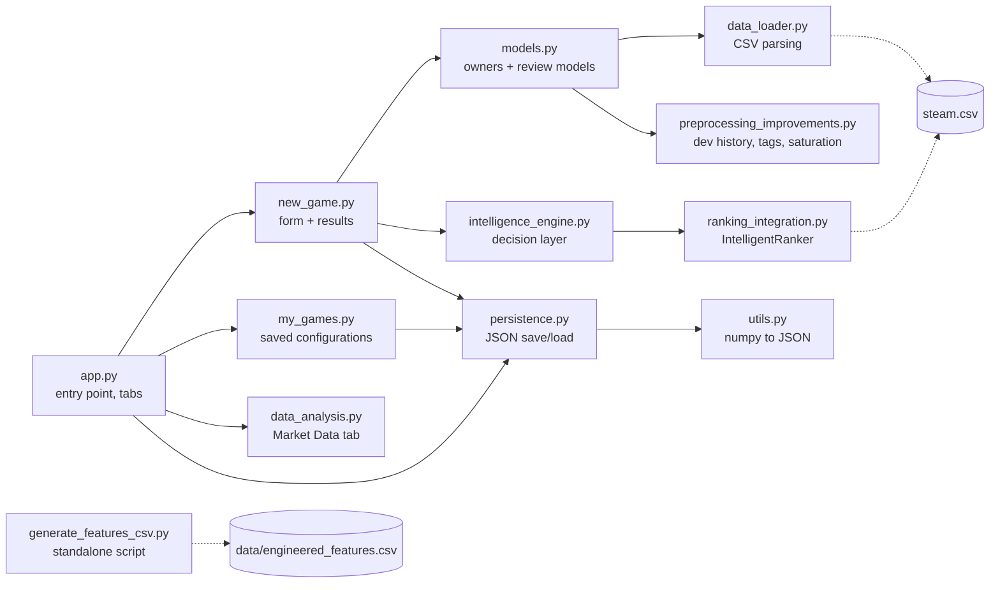
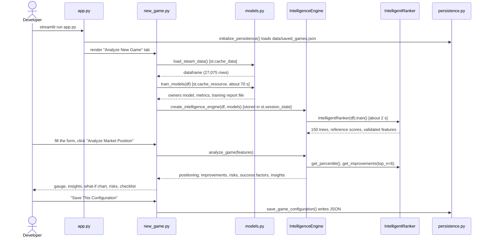

[Previous: Overview](01_overview.md) · [Index](README.md) · **2 Architecture and stack** · [Next: The dataset](03_dataset.md)

# 2. Architecture and technology stack

> **Interactive:** [Lab step 1, click the six stages](https://cocopops9.github.io/Game_Launch_IDSS/#intro)

## 2.1 Technology stack

| Layer | Technology | Role in this project |
|---|---|---|
| User interface | **Streamlit** | three tabs, form widgets, `st.cache_data`, `st.cache_resource`, `st.session_state` |
| Charts in the app | **Plotly** | percentile gauge (`go.Indicator`), improvement bars, feature importance, correlation heatmap, market charts |
| Data handling | **pandas**, **NumPy** | CSV parsing, string matching on `;`-separated fields, feature columns |
| Machine learning | **XGBoost** (`XGBRegressor`) | the ranker and the two secondary regressors |
| ML utilities | **scikit-learn** | `train_test_split`, `cross_val_score`, R², MAE, RMSE |
| Statistics | **SciPy** | `rankdata` (rank target), `spearmanr` (evaluation), `normaltest` (training report) |
| Imported, not used for results | LightGBM, seaborn, matplotlib | imports in `models.py` and `data_analysis.py`; they must be installed for the modules to load |
| Persistence | JSON file | `data/saved_games.json` stores saved configurations |
| Documentation lab | vanilla JavaScript, inline SVG | `docs/index.html` runs the exported trees in the browser |

## 2.2 Module map



GitHub renders this diagram natively; you can zoom and pan it.

## 2.3 What happens when the app starts



## 2.4 Caching semantics (why the first launch is slow and later clicks are fast)

| Object | Mechanism | Lifetime | Cost |
|---|---|---|---|
| Loaded dataframe | `@st.cache_data` on `load_steam_data` | server process; each caller gets a copy | seconds |
| Owners and review models | `@st.cache_resource` on `train_models` | server process, shared by all users | about 70 s, once |
| Ranker and decision engine | `st.session_state.intelligence_engine` | one browser session | about 2 s per new session |
| Analysis of a configuration | none | recomputed on every click | milliseconds |

Nothing is written to disk except the training report: every call of `train_models` creates a new
`training_report_YYYYMMDD_HHMMSS.md` in the working directory. Restarting the server retrains everything.

## 2.5 The three tabs

| Tab | File | Content |
|---|---|---|
| **Analyze New Game** | `new_game.py` | the configuration form; after *Analyze*: percentile metric and gauge, tier, readiness, insights, improvement chart and details, risk list, success-factor checklist, *Save* button |
| **My Configurations** | `my_games.py` | ranking table of every saved configuration (sorted by percentile), per-game details, delete buttons, CSV export |
| **Market Data** | `data_analysis.py` | dataset overview, feature importance of the owners model, correlations (selectable heatmap), model performance, price and platform insights |

The *Market Data* tab only works after the first tab has loaded the data and trained the models; otherwise it shows a warning.

## 2.6 Persistence format

`persistence.py` keeps two synchronized structures in `st.session_state` and mirrors them to `data/saved_games.json`:

```json
{
  "saved_games": {
    "My Awesome Game": [
      {
        "config_id": "My Awesome Game_1699123456789",
        "timestamp": "2025-11-04 18:04:16",
        "game_name": "My Awesome Game",
        "features": { "price": 14.99, "platforms": ["windows"], "genres": ["Indie"], "tags": ["Singleplayer"],
                      "categories": [], "release_month": 11, "achievements": 0, "required_age": 0 },
        "predictions": { "percentile": 46.7, "tier": "average", "readiness_score": 0 }
      }
    ]
  },
  "configurations": [ "the same entries, flattened for the ranking table" ]
}
```

`config_id` is the game name plus a millisecond timestamp, so deleting and re-saving never produces duplicate identifiers.
`migrate_old_config_ids` rewrites identifiers of an older `Game_config_N` format when the file is loaded.
`utils.convert_numpy_types` converts NumPy scalars and arrays to native Python types before `json.dump`.

---
[Previous: Overview](01_overview.md) · [Index](README.md) · **2 Architecture and stack** · [Next: The dataset](03_dataset.md)
