[Previous: Architecture and stack](02_architecture_and_stack.md) · [Index](README.md) · **3 The dataset** · [Next: Feature engineering](04_feature_engineering.md)

# 3. The dataset

> **Interactive:** [Lab step 2, the data](https://cocopops9.github.io/Game_Launch_IDSS/#data) (log or linear scale, random or temporal split)

## 3.1 Source and schema

`steam.csv` contains **27,075 games** and 18 columns. Its schema matches the public Kaggle *Steam Store Games* dataset
(Steam store data joined with SteamSpy estimates); the latest release date in the file is 2019-05-01.

| Column | Example (Counter-Strike) | Known before launch? | Used as |
|---|---|---|---|
| `appid`, `name` | 10, Counter-Strike | yes | identifiers only |
| `release_date` | 2000-11-01 | yes | time features |
| `english` | 1 | yes | owners model only |
| `developer`, `publisher` | Valve, Valve | yes | studio size, top-20 developer flags |
| `platforms` | `windows;mac;linux` | yes | platform flags |
| `required_age` | 0 | yes | age rating features |
| `categories` | `Multi-player;Online Multi-Player;...` | yes | Steam feature flags |
| `genres` | `Action` | yes | genre flags |
| `steamspy_tags` | `Action;FPS;Multiplayer` | mostly (tags are user-voted) | tag flags |
| `achievements` | 0 | yes | achievement features |
| `price` | 7.19 | yes | price features |
| `positive_ratings`, `negative_ratings` | 124534, 3339 | **no** | review-ratio *target* only |
| `average_playtime`, `median_playtime` | 17612, 317 | **no** | not used |
| `owners` | `10000000-20000000` | **no** | the *target* |

Post-launch columns never enter the feature set. In `models.py` the comment block "REMOVED: POST-LAUNCH ENGAGEMENT FEATURES"
documents this choice: ratings and playtime would leak the outcome into the inputs.

## 3.2 The target: owners ranges

SteamSpy publishes owners as ranges. `SteamDataLoader.parse_owners_range` turns `"20000-50000"` into its midpoint, 35,000.

| Range | Midpoint | Games | Share |
|---|---:|---:|---:|
| 0 to 20k | 10,000 | 18,596 | 68.7% |
| 20k to 50k | 35,000 | 3,059 | 11.3% |
| 50k to 100k | 75,000 | 1,695 | 6.3% |
| 100k to 200k | 150,000 | 1,386 | 5.1% |
| 200k to 500k | 350,000 | 1,272 | 4.7% |
| 500k to 1M | 750,000 | 513 | 1.9% |
| 1M to 2M | 1,500,000 | 288 | 1.1% |
| 2M to 5M | 3,500,000 | 193 | 0.7% |
| 5M to 10M | 7,500,000 | 46 | 0.17% |
| 10M to 20M | 15,000,000 | 21 | 0.08% |
| 20M to 50M | 35,000,000 | 3 | 0.01% |
| 50M to 100M | 75,000,000 | 2 | 0.01% |
| 100M to 200M | 150,000,000 | 1 | 0.004% |

Two statistical properties drive every later design decision:

* **Interval censoring.** The true owner count is only known to lie inside a range. The midpoint is a convention, not a measurement,
  and two games in the same range are indistinguishable. With 13 possible values the target has massive **ties**.
* **Heavy tail.** Mean 134,090, median 10,000, skewness about 70. A squared-error regression on raw owners would be dominated
  by a handful of blockbusters; even on log scale, R² stays near 0.36.

The rank target of chapter 6 is designed around both properties.

## 3.3 Time: two different validation splits

Release years are concentrated at the end: 2016 to 2018 alone contain 18,878 games (70%). The code validates its models in two
different ways, and the difference matters (chapter 11):

| Model | Split | Train | Test | What it measures |
|---|---|---:|---:|---|
| Ranker (`ranking_integration.py`) | random, `train_test_split(test_size=0.2, random_state=42)` | 21,660 | 5,415 | ordering of games drawn from the same period |
| Owners and review models (`models.py`) | temporal, cutoff `2018-01-01` | 16,702 | 10,373 | ordering of *future* games from the past |

## 3.4 Data quality notes

| Fact | Where | Effect |
|---|---|---|
| Missing owners default to 10,000 | `parse_owners_range` | none in `steam.csv` (no missing values) |
| Games without ratings would get `review_ratio = 0.7` | `SteamDataLoader.preprocess_steam_data` | no effect on `steam.csv`: every game has at least one rating |
| 1 missing developer, 14 missing publishers | `steam.csv` | the loader fills them with `0`, which then counts as one more "studio" |
| Game age is measured from a fixed date, `2017-05-01` | `_engineer_features` | the 15,048 games (55.6%) released later get `game_age_days = 0` after clipping |
| `release_year` missing values default to 2015 | `_engineer_features` | no missing dates in `steam.csv` |
| `SteamDataLoader` checks `df['owners'].dtype == 'object'` | `data_loader.py` | with **pandas 3.x** strings have a new dtype, the check fails and every game gets 1,000 owners. Use pandas 2.x (see `requirements.txt`) |

---
[Previous: Architecture and stack](02_architecture_and_stack.md) · [Index](README.md) · **3 The dataset** · [Next: Feature engineering](04_feature_engineering.md)
