[Previous: The dataset](03_dataset.md) · [Index](README.md) · **4 Feature engineering** · [Next: Gradient boosting](05_gradient_boosting.md)

# 4. Feature engineering

> **Interactive:** [Lab step 3, configure a game](https://cocopops9.github.io/Game_Launch_IDSS/#configure) and
> [Lab step 4, watch the 91 cells light up](https://cocopops9.github.io/Game_Launch_IDSS/#features)

A tree model needs a fixed-length numeric vector per game. `IntelligentRanker._engineer_features`
(`ranking_integration.py`) builds that vector from the raw columns of `steam.csv`.

## 4.1 The 91 ranker features

| Family | Count | Columns | Construction |
|---|---:|---|---|
| Price | 4 | `price`, `price_log`, `is_free`, `price_tier` | `log1p(price)`; `price == 0`; bins (0], (0, 5], (5, 10], (10, 20], (20, 40], (40, 1000] mapped to 0 to 5 |
| Time | 4 | `game_age_days`, `game_age_log`, `release_year`, `release_month` | days between release and 2017-05-01, clipped to [0, 10000]; `log1p` of it; calendar year and month |
| Platforms | 4 | `windows`, `mac`, `linux`, `platform_count` | substring tests on `platforms`; their sum |
| Achievements | 3 | `achievements`, `has_achievements`, `achievements_log` | count, count > 0, `log1p(count)` |
| Age rating | 2 | `required_age`, `is_mature` | value; value >= 18 |
| Categories | 12 | `cat_single_player`, `cat_multi_player`, `cat_online_multi_player`, `cat_steam_achievements`, `cat_steam_trading_cards`, `cat_steam_cloud`, `cat_full_controller_support`, `cat_co_op`, `cat_online_co_op`, `cat_in_app_purchases`, `cat_vr_support`, `cat_steam_workshop` | substring test on `categories` |
| Genres | 12 | `genre_indie`, `genre_action`, `genre_casual`, `genre_adventure`, `genre_strategy`, `genre_simulation`, `genre_rpg`, `genre_early_access`, `genre_free_to_play`, `genre_sports`, `genre_racing`, `genre_massively_multiplayer` | substring test on `genres` |
| Tags | 26 | `tag_action`, `tag_casual`, `tag_adventure`, `tag_strategy`, `tag_simulation`, `tag_rpg`, `tag_free_to_play`, `tag_puzzle`, `tag_fps`, `tag_multiplayer`, `tag_indie`, `tag_singleplayer`, `tag_open_world`, `tag_survival`, `tag_horror`, `tag_platformer`, `tag_sandbox`, `tag_2d`, `tag_pixel_graphics`, `tag_roguelike`, `tag_vr`, `tag_sports`, `tag_racing`, `tag_anime`, `tag_story_rich`, `tag_co_op` | substring test on `steamspy_tags` |
| Developer | 22 | `dev_game_count`, `dev_game_count_log`, `dev_top_1` ... `dev_top_20` | games by the same developer in the whole file; `log1p`; one-hot flags for the 20 most prolific developers |
| Publisher | 2 | `pub_game_count`, `pub_game_count_log` | games by the same publisher; `log1p` |
| **Total** | **91** | | |

The source comment in `_engineer_features` says "~87 features"; the code actually creates 91, which is the number the trained model uses.

### Techniques, and why each one suits trees

* **Logarithmic transforms** (`log1p`) compress long tails such as price and achievement counts. Trees are invariant to monotone
  transforms of a single feature, so `price` and `price_log` produce the same possible splits; the duplicate mainly changes how often
  `colsample_bytree` offers the information to a tree.
* **Binning** (`price_tier`) exposes business-meaningful thresholds directly.
* **Multi-hot flags** turn `;`-separated text lists into one binary column per value. Matching uses
  `str.contains(value, case=False)`, a case-insensitive **substring** (and regular expression) test: `Multi-player` also matches
  `Online Multi-Player`, `RPG` also matches `JRPG`, and `Partial Controller Support` does *not* set `cat_full_controller_support`.
* **Frequency encoding** (`dev_game_count`) summarizes a high-cardinality text column (thousands of studios) as one number.
* **One-hot encoding of the top 20 developers** lets the model treat the most prolific studios individually.

Model inputs must be numeric and finite: `X.fillna(0).replace([inf, -inf], 0)` runs before training and before every prediction,
and column names are sanitized to `[A-Za-z0-9_]` for XGBoost.

## 4.2 From the Streamlit form to the 91 columns

At prediction time there is no `steam.csv` row, only the form of `new_game.py`.
`IntelligenceEngine._build_ranker_features` maps it to a dictionary, and `_predict_rank` creates the 91-column row with
`features.get(col, 0)`: every column not in the dictionary becomes **0**.

| Form input | Columns written | Notes |
|---|---|---|
| Price | `price`, `price_log`, `is_free`, `price_tier` | same tier boundaries as training |
| Platforms | `windows`, `mac`, `linux`, `platform_count` | |
| Number of achievements | `achievements`, `has_achievements`, `achievements_log` | |
| Release month | `release_month` | |
| Genres | `genre_<name>` | *Puzzle* and *Horror* produce `genre_puzzle` and `genre_horror`, which are not model columns |
| Tags | `tag_<name>` | *Atmospheric*, *Retro*, *Fantasy*, *Sci-fi*, *Tower Defense* produce columns the model does not have |
| Steam features | `cat_<name>` | *Shared/Split Screen* and *Steam Leaderboards* produce columns the model does not have |
| Age rating | none | `required_age` is collected by the form but never copied into the dictionary |
| (no field) | `game_age_days = 100`, `release_year = 2024`, `dev_game_count = 1` | hard-coded defaults |

Consequences that are easy to miss:

* **Inputs with no effect:** the age rating, 2 of 14 genres, 5 of 20 tags and 2 of 10 Steam features never change the result.
  The lab draws them with a dashed red border.
* **Columns the form can never set:** 39 of the 91 columns are always 0 and 5 more always hold the fixed defaults above. The 39 include the
  most important feature of the model, `tag_free_to_play` (choosing the *Free to Play* genre sets `genre_free_to_play`, not the tag),
  as well as `tag_casual`, `tag_indie`, `cat_in_app_purchases`, all `dev_top_*` flags and both publisher columns.
* **Out-of-range defaults:** `release_year = 2024` is later than any training game (max 2019) and `pub_game_count = 0` never occurs
  in training (every game has at least one publisher game). A tree simply routes such values to the side of its largest or smallest
  threshold, so the prediction behaves as for the newest games and the smallest publishers.

## 4.3 The secondary feature set (134 columns)

`models.enhanced_feature_engineering` builds a larger set for the owners and review regressions:

| Group | Count | Examples |
|---|---:|---|
| Price | 5 | adds `price_squared`; tier bins differ (0, 5, 10, 20, 40, 60, 100) |
| Time | 7 | adds `game_age_years`, `release_quarter`, `is_holiday_release` (June, July, November, December) |
| Age, platforms, language | 9 | adds `is_cross_platform`, `is_all_platforms`, `english` |
| Achievements | 4 | adds `achievements_tier` (bins 0, 1, 10, 50, 100, 1000) |
| Categories | 18 | 17 categories plus `num_categories` |
| Genres | 28 | all 27 Steam genres plus `num_genres` |
| Tags | 27 | `num_tags` plus 26 tags kept by `ImprovedPreprocessor.filter_rare_tags` (tags in at least 1% of games) |
| Developer and publisher | 25 | `dev_top_1..20`, `developer_game_count`, `is_prolific_developer`, `publisher_game_count`, `is_major_publisher`, `is_self_published` |
| Interactions | 3 | `indie_multiplatform`, `price_x_action`, `platforms_x_price` |
| Developer history | 5 | `dev_prior_avg_owners`, `dev_prior_avg_owners_log`, `dev_prior_median_owners`, `dev_experience`, `dev_consistency` |
| Market saturation | 3 | games released in the same month and quarter, and its log |
| **Total** | **134** (after duplicate removal) | |

The developer-history features were designed to use only games released *before* each game (no leakage), but two implementation
issues make them uninformative in practice; see [chapter 11](11_limitations.md). These features do not affect the ranker.

`generate_features_csv.py` is a standalone script that writes a comparable engineered table to `data/engineered_features.csv`
(27,075 rows) for inspection outside the app.

---
[Previous: The dataset](03_dataset.md) · [Index](README.md) · **4 Feature engineering** · [Next: Gradient boosting](05_gradient_boosting.md)
