[Previous: Feature engineering](04_feature_engineering.md) · [Index](README.md) · **5 Gradient boosting** · [Next: Rank target and Spearman](06_rank_target_and_spearman.md)

# 5. Gradient boosting with XGBoost

> **Interactive:** [Lab step 5](https://cocopops9.github.io/Game_Launch_IDSS/#boosting): fit a boosted model live on toy data,
> then follow your own configuration through the 150 real trees.

<p align="center"></p>

## 5.1 The model is a sum of trees

The ranker is `xgboost.XGBRegressor` (`IntelligentRanker._train_ensemble`). Its prediction for a game with feature vector $x$ is

$$\hat{y}(x) = b + \sum_{k=1}^{150} f_k(x)$$

where $b$ is a constant (the *base score*) and each $f_k$ is a regression tree: a sequence of yes/no questions of the form
"is feature $j$ smaller than threshold $t$?" ending in a leaf that holds a number. Evaluating the model means walking each tree from
its root to one leaf and adding up the 150 leaf values. In the snapshot, $b = 0.50002$, which is the mean of the rank target
$(n + 1) / 2n$ for $n = 21{,}660$; XGBoost 2.0 and later estimate the base score from the training target.

## 5.2 Boosting: each tree corrects the previous ones

Trees are added one at a time. Tree $t$ is chosen to reduce the loss of the model built so far:

$$\mathcal{L}^{(t)} = \sum_{i=1}^{n} \ell\big(y_i,\ \hat{y}_i^{(t-1)} + f_t(x_i)\big) + \Omega(f_t), \qquad \Omega(f) = \gamma T + \tfrac{1}{2}\lambda \sum_{j=1}^{T} w_j^2$$

with $T$ leaves and leaf values $w_j$. XGBoost approximates the loss to second order around the current prediction, using the
gradient $g_i$ and the Hessian $h_i$ of $\ell$. For the squared error used here, $\ell = \tfrac12 (y - \hat{y})^2$, so

$$g_i = \hat{y}_i^{(t-1)} - y_i \quad(\text{minus the residual}), \qquad h_i = 1 .$$

For a fixed tree structure, the best value of leaf $j$ and the quality of a candidate split follow in closed form
($G$ and $H$ are sums of $g_i$ and $h_i$ over the games reaching a leaf):

$$w_j^{*} = -\frac{G_j}{H_j + \lambda}, \qquad
\text{Gain} = \frac12\left[\frac{G_L^2}{H_L+\lambda} + \frac{G_R^2}{H_R+\lambda} - \frac{(G_L+G_R)^2}{H_L+H_R+\lambda}\right] - \gamma .$$

With $h_i = 1$, $H$ is simply the number of games in a node, and $w^{*}$ is a shrunk average residual. Finally the new tree is
**shrunk** by the learning rate $\eta$ before it is added:

$$\hat{y}^{(t)} = \hat{y}^{(t-1)} + \eta\, f_t(x), \qquad \eta = 0.08 .$$

Small steps make each tree a modest correction, which generalizes better than a few large ones. The animation above shows the
same mechanism on 28 toy points: the step function starts at the mean, then each depth-2 tree removes part of the remaining
residuals. The training error always decreases; whether the later trees still help can only be judged on held-out data, which
is why every reported metric in this project is computed on a test split.

## 5.3 The hyperparameters of the ranker

```python
XGBRegressor(n_estimators=150, learning_rate=0.08, max_depth=6, min_child_weight=3,
             subsample=0.8, colsample_bytree=0.8, random_state=42, n_jobs=-1)
```

| Parameter | Value | Meaning |
|---|---|---|
| `n_estimators` | 150 | number of trees $K$ |
| `learning_rate` | 0.08 | shrinkage $\eta$ applied to every tree |
| `max_depth` | 6 | at most 6 questions from root to leaf, so at most 64 leaves and interactions of up to 6 features |
| `min_child_weight` | 3 | minimum $H$ in a child; with $h_i = 1$, at least 3 games per leaf |
| `subsample` | 0.8 | each tree sees a random 80% of the training games (stochastic gradient boosting) |
| `colsample_bytree` | 0.8 | each tree may only split on a random 80% of the 91 features |
| `random_state` | 42 | makes the random sampling reproducible |
| not set | defaults | `reg_lambda` $\lambda = 1$, `gamma` $\gamma = 0$, squared-error objective, histogram tree method |

No early stopping and no hyperparameter search are performed for the ranker; the values are fixed in the code. The two secondary
regressors in `models.py` use similar settings (chapter 10).

## 5.4 How big is the trained model?

The snapshot contains 150 trees with **15,186 nodes** in total (about 101 per tree, out of a maximum of 127 for depth 6).
Leaf values in the exported trees already include the factor $\eta$. To score one configuration the lab walks 150 root-to-leaf
paths of at most 6 comparisons, which takes well under a millisecond. Comparisons are done in single precision, as in XGBoost:
on 25 stored test rows the browser matches Python's predictions within $2.5 \times 10^{-7}$.

## 5.5 Which features does the model use most?

XGBoost's `feature_importances_` (average split gain per feature, normalized to sum to 1) for the snapshot:

| Rank | Feature | Importance | Comment |
|---:|---|---:|---|
| 1 | `tag_free_to_play` | 0.117 | free-to-play games reach far more owners |
| 2 | `genre_free_to_play` | 0.087 | the same information from the genre list |
| 3 | `game_age_days` | 0.072 | older games had more time to accumulate owners |
| 4 | `cat_steam_trading_cards` | 0.070 | since 2017 Valve enables Trading Cards only after a game passes a sales and engagement threshold, so for recent games the flag is partly a *consequence* of success |
| 5 | `price_tier` | 0.029 | |
| 6 | `tag_open_world` | 0.029 | |
| 7 | `tag_casual` | 0.023 | |
| 8 | `release_year` | 0.022 | |
| 9 | `tag_survival` | 0.020 | |
| 10 | `tag_multiplayer` | 0.020 | |
| 11 | `dev_top_16` | 0.019 | one specific prolific developer |
| 12 | `tag_indie` | 0.018 | |

Gain importance says how much a feature helps *predict*; it does not say in which direction it acts, and it does not measure a
causal effect. The Trading Cards row is the clearest example of why: the flag correlates with success partly because success
unlocks it (chapter 11).

## 5.6 Why gradient-boosted trees fit this problem

* The inputs are mostly **binary flags** plus a few skewed numbers; trees need no scaling or normalization.
* Trees capture **interactions** (for example free-to-play *and* multiplayer) without hand-made product features.
* Splits only depend on the **order** of each feature's values, so monotone transforms of an input do not change the model.
* Irrelevant features are simply not chosen for splits, and column subsampling spreads the work over correlated duplicates.

---
[Previous: Feature engineering](04_feature_engineering.md) · [Index](README.md) · **5 Gradient boosting** · [Next: Rank target and Spearman](06_rank_target_and_spearman.md)
