[Previous: Gradient boosting](05_gradient_boosting.md) · [Index](README.md) · **6 Rank target and Spearman** · [Next: Score to percentile](07_percentile_mapping.md)

# 6. The rank target and the Spearman correlation

> **Interactive:** [Lab step 6](https://cocopops9.github.io/Game_Launch_IDSS/#ranking): distort the scores of 800 real held-out
> games and watch Spearman stay put while Pearson moves.

<p align="center"></p>

## 6.1 What the model is trained to predict

The ranker does not regress owners. In `IntelligentRanker._train_ensemble`:

```python
y_train_rank = rankdata(y_train) / len(y_train)
m1.fit(X_train, y_train_rank)
```

`scipy.stats.rankdata` replaces each value by its position in the sorted list, giving **tied values their average position**.
Dividing by $n$ maps the ranks into $(0, 1]$:

$$y_i^{\text{rank}} = \frac{1}{n}\left(\#\{k : y_k < y_i\} + \frac{1 + \#\{k : y_k = y_i\}}{2}\right)$$

Because owners take only 13 values, the 21,660 training games collapse onto 13 target values:

| Owners range | Training games | Rank target |
|---|---:|---:|
| 0 to 20k | 14,966 | 0.3455 |
| 20k to 50k | 2,404 | 0.7465 |
| 50k to 100k | 1,336 | 0.8328 |
| 100k to 200k | 1,096 | 0.8889 |
| 200k to 500k | 1,009 | 0.9375 |
| 500k to 1M | 403 | 0.9701 |
| 1M to 2M | 228 | 0.9847 |
| 2M to 5M | 156 | 0.9936 |
| 5M to 10M | 40 | 0.9981 |
| 10M to 20M | 18 | 0.9994 |
| 20M to 50M | 2 | 0.9999 |
| 50M to 100M | 1 | 1.0000 |
| 100M to 200M | 1 | 1.0000 |

### Why this target

* **Robust to the heavy tail.** A 150-million-owner game and a 3-million-owner game differ by 0.006 in the target, so a few
  blockbusters cannot dominate the squared error.
* **Faithful to censoring.** Only the order of ranges is used, never the arbitrary midpoints.
* **Aligned with the output.** The app reports a percentile, which depends only on order; training on order optimizes what is used.

### What kind of "ranking model" this is

The code calls it "XGBoost Rank", but it is a **pointwise** approach: an ordinary squared-error regression on a rank-transformed
target. XGBoost also provides pairwise and listwise learning-to-rank objectives (`XGBRanker`, `rank:pairwise`, `rank:ndcg`), which
optimize the order of pairs or lists directly; they are **not** used here.

Also note that the raw score is not bounded by $[0, 1]$: on the test split it ranges from 0.24 to 1.13, because a sum of leaves
can overshoot the targets it was fitted to. Only its order matters (chapter 7).

## 6.2 Measuring order: Spearman's ρ

Spearman's rank correlation is the Pearson correlation computed on ranks:

$$\rho = \frac{\operatorname{cov}\big(R(y), R(\hat{y})\big)}{\sigma_{R(y)}\,\sigma_{R(\hat{y})}}$$

Without ties it reduces to $\rho = 1 - \dfrac{6 \sum_i d_i^2}{n(n^2 - 1)}$ with $d_i$ the rank difference of game $i$.
It equals +1 when the predicted order matches the true order exactly, 0 when the order is unrelated, and it is unchanged by any
increasing transformation of either variable. The code computes it with `scipy.stats.spearmanr(y_test, predictions)` on the
5,415 test games.

<p align="center"></p>

## 6.3 How to read 0.725

| Quantity | Value | How it was obtained |
|---|---:|---|
| Spearman ρ, random split | **0.725** | `spearmanr` on the 5,415 test games (the number the app shows) |
| 95% bootstrap interval | 0.712 to 0.738 | 1,000 resamples of the test games, computed for this documentation |
| Highest ρ reachable by tie-free predictions | 0.835 | the ties in the target cap ρ: 67% of test games share one owners range, while model scores are almost all distinct |
| Same recipe, temporal split | **0.432** | train on games before 2018, test on 10,373 games from 2018 on; computed for this documentation |
| Random split without `game_age_*` and `release_year` | 0.670 | computed for this documentation |

Three conclusions follow:

1. On games from the same period, the model orders games well: 0.725 is about 87% of the 0.835 ceiling imposed by ties.
2. A large part of that skill comes from **time on the market**. Removing the age and year features costs 0.055; testing on
   *later* games, which is the real use case for an unreleased title, costs 0.29.
3. The app's reliability threshold (`spearman_score >= 0.60` gives "High" confidence) is passed on the random split, but would not be
   passed under temporal validation. The interface does not show the temporal figure. See [chapter 11](11_limitations.md).

The app also labels the ranker's score with `random_spearman` and `temporal_spearman`; both attributes hold the same random-split
value (`self.temporal_spearman = self.spearman_score`), and the "cross-validation" mentioned in `analyze_game`'s note is a single
holdout split.

---
[Previous: Gradient boosting](05_gradient_boosting.md) · [Index](README.md) · **6 Rank target and Spearman** · [Next: Score to percentile](07_percentile_mapping.md)
