[Previous: Rank target and Spearman](06_rank_target_and_spearman.md) · [Index](README.md) · **7 Score to percentile** · [Next: The what-if engine](08_what_if_engine.md)

# 7. From raw score to market percentile

> **Interactive:** [Lab step 7](https://cocopops9.github.io/Game_Launch_IDSS/#percentile): the reference curve with your score on it.

<p align="center"></p>

## 7.1 The reference distribution

At the end of `IntelligentRanker.train`:

```python
self.reference_ranks = self.ranking_models['xgb_rank'].predict(X_test)
```

The reference set is the model's own scores for the **5,415 test games**: real games, unseen during training. They form the
yardstick against which any new configuration is measured.

## 7.2 The mapping

`IntelligentRanker.get_percentile`:

```python
percentile = np.searchsorted(np.sort(self.reference_ranks), rank_score) / len(self.reference_ranks) * 100
return min(99, max(1, percentile))
```

`np.searchsorted` with its default `side='left'` returns the number of reference scores **strictly below** the new score.
Formally, with $s_1 \le \dots \le s_N$ the sorted reference scores and $N = 5{,}415$,

$$P(s) = \operatorname{clip}\!\left(\frac{100}{N}\,\#\{k : s_k < s\},\ 1,\ 99\right)$$

which is the empirical cumulative distribution function of the reference scores, in percent. For the default form values,
$s = 0.4030$, 2,529 reference scores are lower, and $P = 2529 / 5415 \times 100 = 46.7$.

## 7.3 What the percentile means, precisely

> "46.7" means: *the model scores this configuration higher than it scores 46.7% of real held-out Steam games.*

It is a statement about **predicted** positions, not about owners. It becomes a statement about owners only to the extent that
the model orders games correctly (Spearman 0.725 on the random split, 0.432 on the temporal one, chapter 6). Comparing with the
model's own predictions, rather than with the true ranks of the test games, has a useful side effect: any constant shift in the
model's scores cancels out.

## 7.4 Sensitivity is not uniform

The curve in the animation is very steep between scores 0.33 and 0.36. That region holds thousands of nearly identical scores
of small games (two thirds of the test split are in the lowest owners range). Consequences:

* Near the bottom of the market, a tiny change of score moves the percentile by many points.
* Near the top, the curve flattens: the same score change buys far fewer percentile points.
* A what-if gain in percentile points (chapter 8) therefore depends on **where** the configuration starts, not only on the feature.

## 7.5 Clipping

The result is clipped to $[1, 99]$, so the app never claims "0th" or "100th". A score below every reference score reports 1;
a score above every reference score reports 99. The *Feature-rich co-op indie* preset of the lab reaches 98.3, close to that ceiling.

---
[Previous: Rank target and Spearman](06_rank_target_and_spearman.md) · [Index](README.md) · **7 Score to percentile** · [Next: The what-if engine](08_what_if_engine.md)
