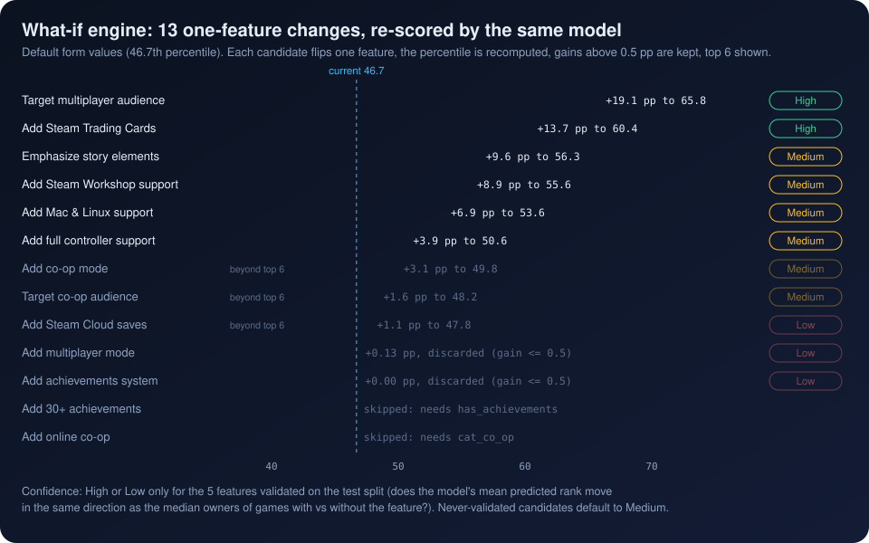

[Previous: Score to percentile](07_percentile_mapping.md) · [Index](README.md) · **8 The what-if engine** · [Next: The decision layer](09_decision_layer.md)

# 8. The what-if engine

> **Interactive:** [Lab step 8](https://cocopops9.github.io/Game_Launch_IDSS/#whatif): all 13 candidates with their status; click
> *apply* to push a change through the form and compare with the engine's prediction.

<p align="center"></p>

## 8.1 Algorithm

`IntelligentRanker.get_improvements(features, top_n)` is a one-at-a-time **counterfactual sensitivity analysis**:

```text
base = percentile(features)
for (feature, target, description, dependency) in 13 candidates:
    skip if the feature is not a model column
    skip if features[feature] >= target            # already present
    skip if dependency and features[dependency] < 1
    modified = copy(features); modified[feature] = target
    gain = percentile(modified) - base
    keep if gain > 0.5 percentile points
sort kept candidates by gain, return the first top_n
```

`IntelligenceEngine.analyze_game` calls it with `top_n=6`. Each candidate costs one extra model evaluation, so one analysis
evaluates the 150 trees at most 15 times (the base percentile is computed once by `analyze_game` and once more inside
`get_improvements`, plus up to 13 candidates).

## 8.2 The 13 candidates

| Feature set | To | Description shown | Requires |
|---|---|---|---|
| `platform_count` | 3 | Add Mac & Linux support | `windows = 1` |
| `has_achievements` | 1 | Add achievements system | |
| `achievements` | 30 | Add 30+ achievements | `has_achievements = 1` |
| `cat_steam_trading_cards` | 1 | Add Steam Trading Cards | |
| `cat_steam_cloud` | 1 | Add Steam Cloud saves | |
| `cat_multi_player` | 1 | Add multiplayer mode | |
| `cat_co_op` | 1 | Add co-op mode | |
| `cat_online_co_op` | 1 | Add online co-op | `cat_co_op = 1` |
| `cat_full_controller_support` | 1 | Add full controller support | |
| `cat_steam_workshop` | 1 | Add Steam Workshop support | |
| `tag_multiplayer` | 1 | Target multiplayer audience | |
| `tag_co_op` | 1 | Target co-op audience | |
| `tag_story_rich` | 1 | Emphasize story elements | |

## 8.3 Worked example (default form values, base 46.7)

| Candidate | Gain (pp) | New percentile | Outcome |
|---|---:|---:|---|
| Target multiplayer audience | +19.11 | 65.8 | shown #1, High |
| Add Steam Trading Cards | +13.70 | 60.4 | shown #2, High |
| Emphasize story elements | +9.64 | 56.3 | shown #3, Medium |
| Add Steam Workshop support | +8.94 | 55.6 | shown #4, Medium |
| Add Mac & Linux support | +6.87 | 53.6 | shown #5, Medium |
| Add full controller support | +3.90 | 50.6 | shown #6, Medium |
| Add co-op mode | +3.14 | 49.8 | kept, beyond top 6 |
| Target co-op audience | +1.55 | 48.2 | kept, beyond top 6 |
| Add Steam Cloud saves | +1.05 | 47.8 | kept, beyond top 6 |
| Add multiplayer mode | +0.13 | | discarded (gain <= 0.5) |
| Add achievements system | 0.00 | | discarded |
| Add 30+ achievements | | | skipped: needs `has_achievements` |
| Add online co-op | | | skipped: needs `cat_co_op` |

## 8.4 What a gain means, and what it does not

* **Ceteris paribus.** Exactly one column changes. Real changes often move several columns at once.
  *Add Mac & Linux support* sets `platform_count = 3` but leaves `mac = 0` and `linux = 0`, a combination that never occurs in
  the data. Applying the same change through the form also sets `mac` and `linux`; for the default game the engine predicts
  53.6 while the re-analysed form gives **55.5**. The lab's *apply* button shows this comparison for every candidate.
* **Model response, not causal effect.** A gain says how the model's score reacts, which reflects how games *with* the feature
  ranked historically. Features can be markers of success rather than causes (Trading Cards, chapter 5), and tags such as
  *Multiplayer* describe what a game *is*; adding a tag does not add the gameplay behind it.
* **Local.** Gains depend on the starting configuration and on the steepness of the reference curve at that point (chapter 7).
  *Add Steam Trading Cards* is worth +13.7 points for the default configuration, +21.3 for the lab's *Free-to-play MMO*
  preset and +7.3 for its *Premium single-player RPG* preset.

## 8.5 Where the confidence labels come from

`IntelligentRanker._validate_improvements` runs once, after training, on the test split. For seven features it compares
games with the feature (`== 1`) and without it (`== 0`), provided each group has at least 50 games:

```python
model_says_positive = mean(predicted rank | with) > mean(predicted rank | without)
actual_is_positive  = median(owners | with) > median(owners | without)
confidence = 'High' if model_says_positive == actual_is_positive else 'Low'
actual_lift = (median_with / median_without - 1) * 100
```

| Feature | With | Without | Median owners lift | Label |
|---|---:|---:|---:|---|
| `platform_count` | | | | not validated: compares `== 1` with `== 0`, and no test game has 0 platforms |
| `has_achievements` | 3,073 | 2,342 | 0% | Low |
| `cat_steam_trading_cards` | 1,601 | 3,814 | +250% | High |
| `cat_steam_cloud` | 1,441 | 3,974 | 0% | Low |
| `cat_multi_player` | 1,093 | 4,322 | 0% | Low |
| `tag_multiplayer` | 206 | 5,209 | +650% | High |
| `tag_co_op` | | | | not validated: 31 games with the tag, fewer than 50 |

Candidates without a validation entry are labelled **Medium** by default.

**Why three features are "Low" with a lift of exactly 0%.** About 67% of test games sit in the lowest owners range, so the
*median* owners of both groups is 10,000 and the lift is zero; the model, meanwhile, scores games with the feature higher, so
the two booleans disagree. "Low" here means "the median is too coarse to see a difference", not "the feature hurts".
A comparison of mean ranks or of the share of games above 20k owners would be able to detect a difference.

The validation also stores `effect_pct`, the difference of mean predicted ranks divided by the number of test games; because of
that division it is a very small number with no direct interpretation, and the app does not display it.

---
[Previous: Score to percentile](07_percentile_mapping.md) · [Index](README.md) · **8 The what-if engine** · [Next: The decision layer](09_decision_layer.md)
