[Previous: The what-if engine](08_what_if_engine.md) · [Index](README.md) · **9 The decision layer** · [Next: Secondary models and validation](10_secondary_models_and_validation.md)

# 9. The decision layer

> **Interactive:** [Lab step 9](https://cocopops9.github.io/Game_Launch_IDSS/#dashboard): the same dashboard as the Streamlit app,
> updated live for your configuration.

Everything after the percentile is **deterministic rules** in `intelligence_engine.py`. No further learning happens; the rules
translate a number into labels, warnings and sentences.

## 9.1 Tier (`_compute_positioning`)

| Percentile | Tier |
|---|---|
| 95 and above | exceptional |
| 80 to 95 | strong |
| 60 to 80 | above_average |
| 40 to 60 | average |
| 20 to 40 | below_average |
| below 20 | struggling |

Lower bounds are inclusive. `ranking_confidence` is "High" when the ranker's Spearman is at least 0.60, otherwise "Moderate".

## 9.2 Risks (`_assess_risks`)

| Condition | Level | Title | Recommendation |
|---|---|---|---|
| exactly one platform selected | moderate | Limited Platform Support | Consider Mac/Linux ports. |
| price above $40 | high | Premium Pricing Risk | Ensure clear value proposition. |
| percentile below 30 | high | Below-Average Position | Review improvement scenarios. |

## 9.3 Success factors and readiness score (`_analyze_success_factors`)

| Factor | Present when | Impact | Points |
|---|---|---|---:|
| Multi-platform | two or more platforms | high | 30 |
| Achievements | achievements > 0 | medium | 20 |
| Trading Cards | "Steam Trading Cards" checked | medium | 20 |

$$\text{readiness} = \min\Big(100,\ \sum_{\text{present factors}} \text{points}\Big)$$

In code: `score = sum(3 if high else 2 for present factors)`, then `min(100, score * 10)`. The possible values are
0, 20, 30, 40, 50 and **70**; the score can never exceed 70%, although it is displayed on a 0 to 100 scale.
The three factors were chosen by hand; they are not derived from the model.

## 9.4 Insights (`_generate_insights`)

| Percentile | Title | Message |
|---|---|---|
| 70 and above | Strong Position | "Top X% of market. High confidence ranking (Spearman: 0.73)" |
| 40 to 70 | Average Position | "Xth percentile. See improvements below." |
| below 40 | Below Average | "Bottom X%. Review recommendations." |

A second insight repeats the best what-if: "+19.1pp → 66th. Confidence: High". Note that the insight thresholds (70, 40)
differ from the tier thresholds (80, 60, 40): a game at the 75th percentile is "Strong Position" in the insight but
"above average" as a tier.

## 9.5 How `new_game.py` displays the result

| Element | Source |
|---|---|
| *Market Percentile* metric with "Top X%" or "Bottom X%" | `positioning['overall_percentile']` |
| *Success Tier*, *Readiness Score* metrics | tier name, readiness score |
| Gauge with five colored bands (red, orange, yellow, blue, green at 20-point steps) | Plotly `go.Indicator` |
| Key insights boxes | `insights` |
| Improvement chart (current percentile in gray, gain in green) and three expanders | `improvements` |
| Risk expanders | `risks` |
| Present / Missing checklist | `success_factors` |
| Footer note | `confidence_statement` |

Two display details, verified in the code:

* Each improvement expander shows a *Similar Games* metric; it is always 0, because `similar_games_count` is set to 0 in
  `_convert_improvements`.
* The confidence caption under each expander looks up `'high'`, `'medium'`, `'low'` in lower case, while the engine returns
  `'High'`, `'Medium'`, `'Low'`; the caption is therefore empty. The confidence remains visible in the insights and in the lab.

---
[Previous: The what-if engine](08_what_if_engine.md) · [Index](README.md) · **9 The decision layer** · [Next: Secondary models and validation](10_secondary_models_and_validation.md)
